# Cart hardware

The cart's custom mounts, enclosures, pedal mechanisms, and steering hardware, with **33 original STL exports** and a shaded CAD render of every component.

[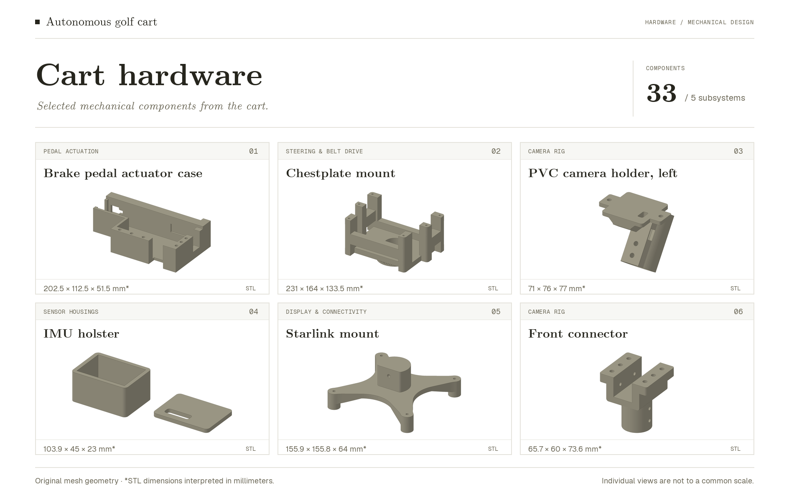](renders/catalog.png)

[Pedal actuation](#pedal-actuation) · [Steering](#steering-and-belt-drive) · [Cameras](#camera-rig) · [Sensors](#sensor-housings) · [Display and connectivity](#display-and-connectivity)

## How the parts fit on the cart

- **Steering:** the chestplate fits over the steering wheel to turn it. The steering models also include the column mount, motor/controller reference, motor pulley, and idler tensioner.
- **Pedals:** linear actuators press the gas and brake from a wooden support structure. The gripper attaches to the column stand and clamps around the steering column, preventing that structure from lifting when the actuators push down on the pedals.
- **Cameras:** camera-specific holders and PVC brackets support the camera rig. The front and back connectors hold the front and rear cameras with vibration dampers.
- **Sensors and accessories:** separate housings support the GPS and IMU; other mounts carry the operator monitor and Starlink equipment.

The installation descriptions above incorporate the builder's identification of the chestplate, gripper, column stand, and front/rear camera connectors. Other component roles follow the export names and the existing subsystem documentation.

## Files and previews

The original filenames and file contents are preserved. Each preview links to its STL; the [landscape component catalog](renders/catalog.png) shows all 33 exports at once and is embedded in the main README. The catalog uses CMU Serif headings with Geist and Geist Mono for small labels, a white background, warm charcoal text, muted olive details, and thin neutral borders. The old front camera holder is retained as a separate revision.

These are **STL mesh exports**, rather than editable Fusion/STEP projects. STL does not encode units: the dimensions below are axis-aligned bounding boxes in the original export axes, **assuming millimeters**. Renders are individually fitted to the frame and are not shown at a common scale. Some exports contain several separate pieces, such as an enclosure and its lid.

## Pedal actuation

The brake and gas cases/covers belong to the pedal actuator assemblies. The piston arm is also shown in the supplied brake-assembly reference. The gripper and column stand retain the wooden pedal-actuator structure.

| CAD preview | Component / original file | Cart location and purpose |
|:--|:--|:--|
| [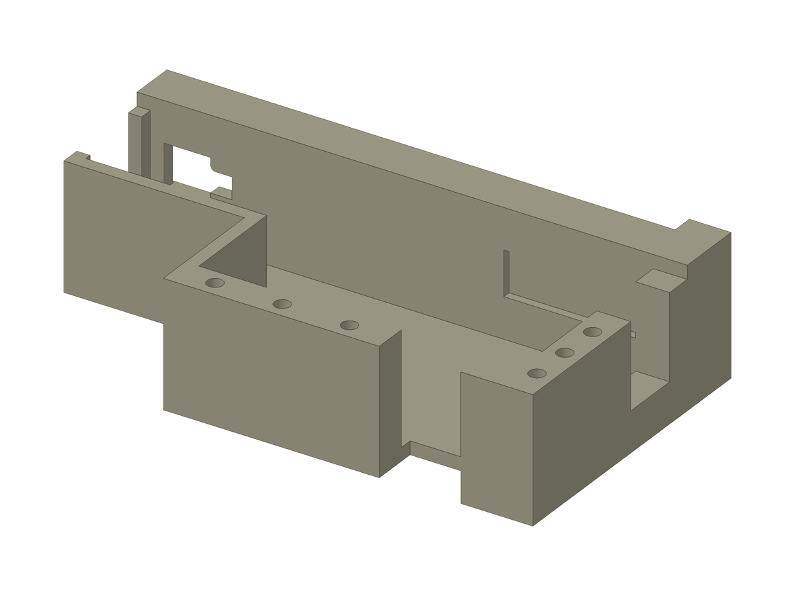](mechanical/pedals/Pedal%20Case%20%28BRAKE%29%20U.stl) | **Brake pedal actuator case**<br>[Pedal Case (BRAKE) U.stl](mechanical/pedals/Pedal%20Case%20%28BRAKE%29%20U.stl)<br>202.5 × 112.5 × 51.5 mm | Brake pedal assembly: case for the actuator mechanism. |
| [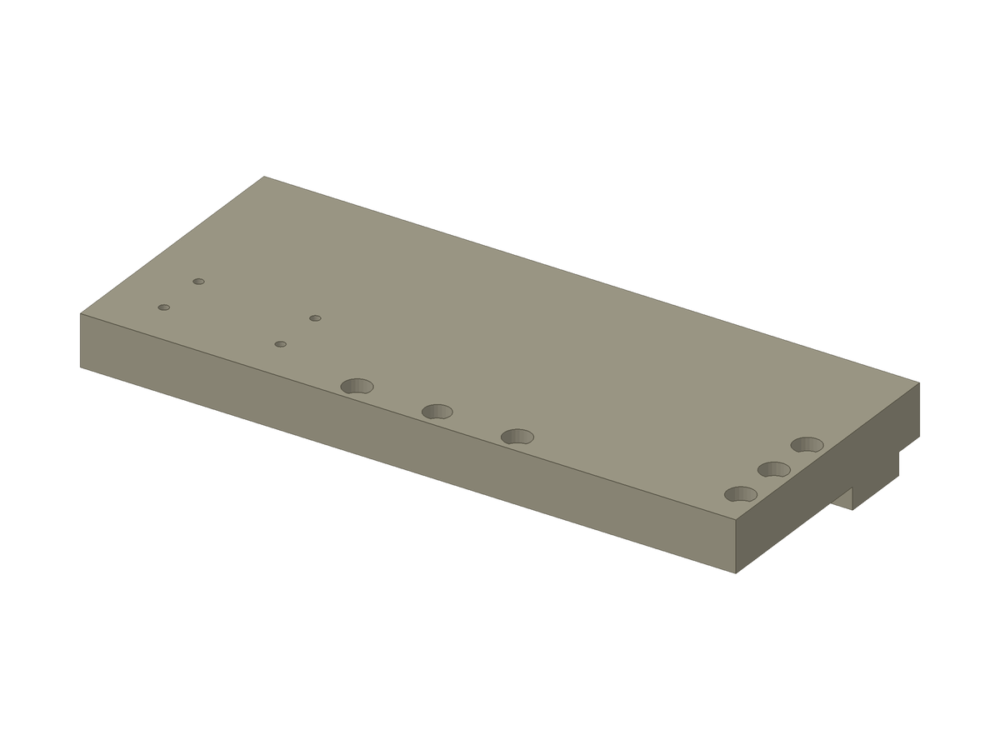](mechanical/pedals/Pedal%20Cover%20%28BRAKE%29%20U.stl) | **Brake pedal actuator cover**<br>[Pedal Cover (BRAKE) U.stl](mechanical/pedals/Pedal%20Cover%20%28BRAKE%29%20U.stl)<br>202.5 × 87.5 × 23 mm | Brake pedal assembly: cover matching the brake case. |
| [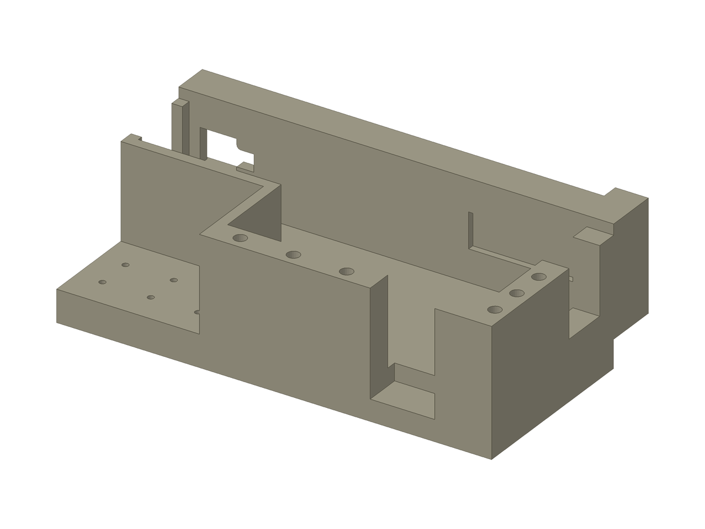](mechanical/pedals/Pedal%20Case%20%28GAS%29%20U.stl) | **Gas pedal actuator case**<br>[Pedal Case (GAS) U.stl](mechanical/pedals/Pedal%20Case%20%28GAS%29%20U.stl)<br>202.5 × 112.5 × 64.5 mm | Accelerator pedal assembly: case for the actuator mechanism. |
| [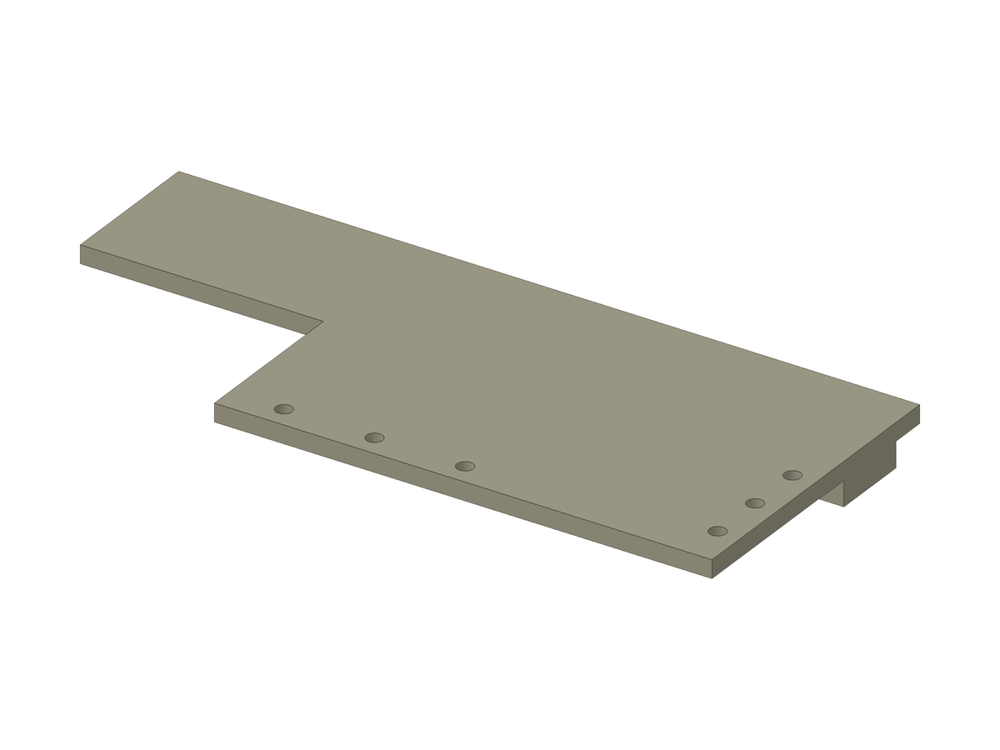](mechanical/pedals/Pedal%20Cover%20%28GAS%29%20U.stl) | **Gas pedal actuator cover**<br>[Pedal Cover (GAS) U.stl](mechanical/pedals/Pedal%20Cover%20%28GAS%29%20U.stl)<br>202.5 × 87.5 × 12 mm | Accelerator pedal assembly: cover matching the gas case. |
| [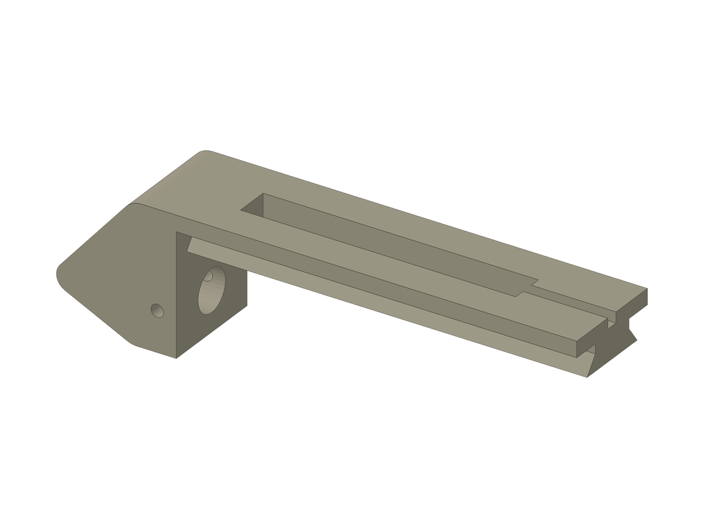](mechanical/pedals/Piston%20Arm.stl) | **Piston arm**<br>[Piston Arm.stl](mechanical/pedals/Piston%20Arm.stl)<br>245.6 × 51.5 × 65 mm | Pedal actuation linkage; also visible as a component in the supplied brake-assembly reference. |
| [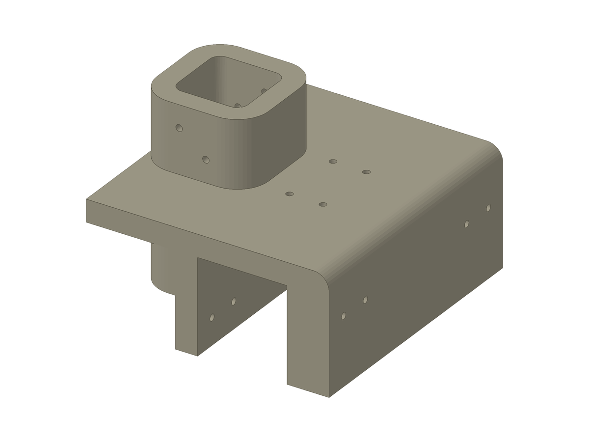](mechanical/pedals/Column%20Stand.stl) | **Column stand**<br>[Column Stand.stl](mechanical/pedals/Column%20Stand.stl)<br>109 × 120 × 82.5 mm | Pedal-frame retention: the stand to which the gripper attaches, linking the wooden actuator-support structure to the clamp on the steering column. |
| [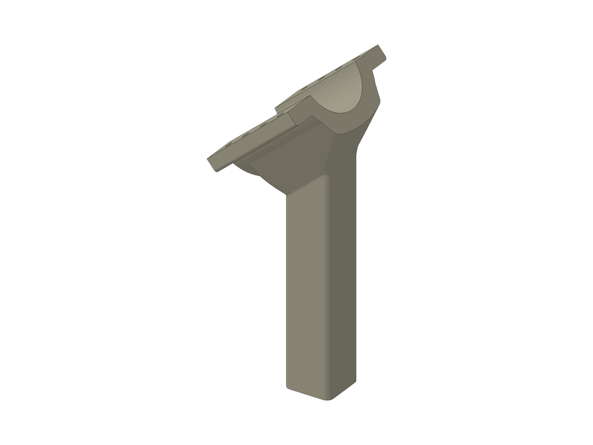](mechanical/pedals/Gripper.stl) | **Gripper**<br>[Gripper.stl](mechanical/pedals/Gripper.stl)<br>72.4 × 91.3 × 193.6 mm | Pedal-frame retention: connected to the column stand and clamped around the steering column to keep the wooden actuator frame from lifting as the actuators press the gas or brake. |
| [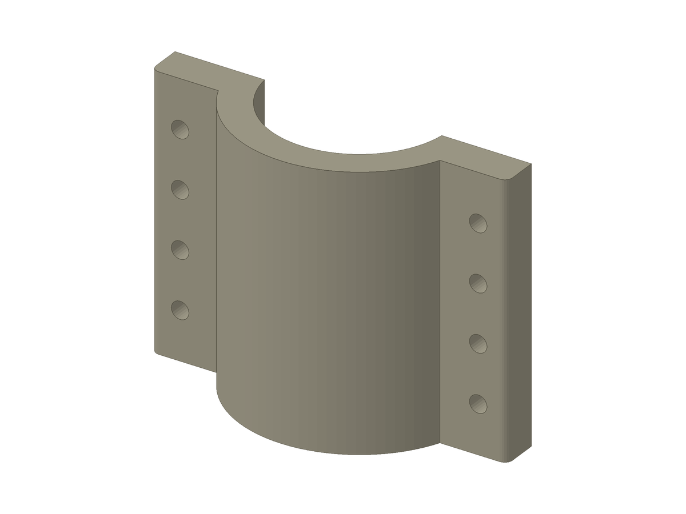](mechanical/pedals/Gripper%20Cover.stl) | **Gripper cover**<br>[Gripper Cover.stl](mechanical/pedals/Gripper%20Cover.stl)<br>91.3 × 28.3 × 69.5 mm | Pedal-frame retention: mating cover for the gripper clamp around the steering column, securing the wooden pedal-actuator frame against lift. |

## Steering and belt drive

The chestplate is the steering-wheel interface. These parts support the ODrive-driven steering system and belt transmission. The motor export contains reference geometry for the motor and controller.

| CAD preview | Component / original file | Cart location and purpose |
|:--|:--|:--|
| [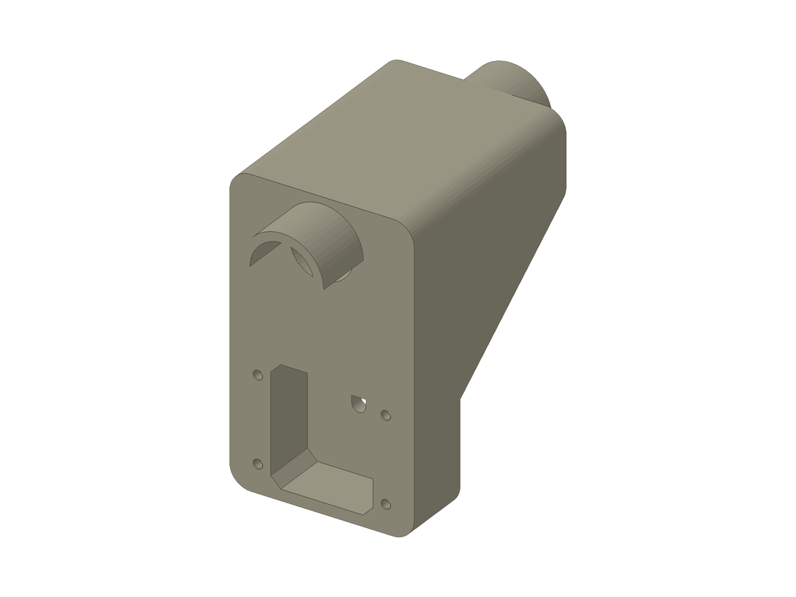](mechanical/steering/Steering%20Column%20Mount.stl) | **Steering column mount**<br>[Steering Column Mount.stl](mechanical/steering/Steering%20Column%20Mount.stl)<br>130 × 248 × 214 mm | Steering assembly: mounting bracket at the steering column. |
| [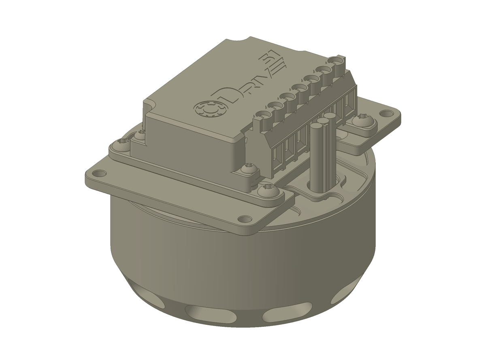](mechanical/steering/Motor.stl) | **Steering motor and controller model**<br>[Motor.stl](mechanical/steering/Motor.stl)<br>91.7 × 100 × 85.4 mm | Steering assembly: supplied motor and controller geometry for packaging and fit reference; not identified as a printable custom part. |
| [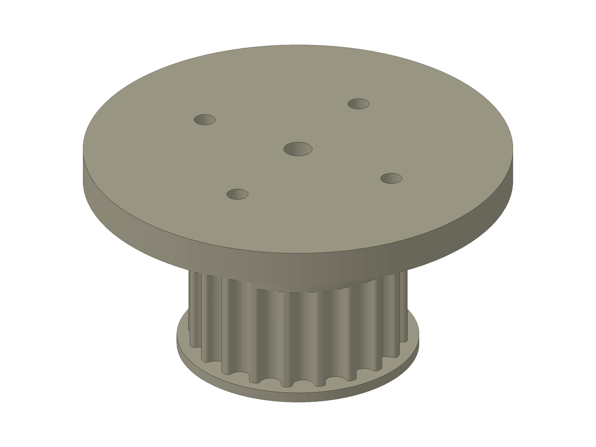](mechanical/steering/Motor%20Belt%20Pulley.stl) | **Motor belt pulley**<br>[Motor Belt Pulley.stl](mechanical/steering/Motor%20Belt%20Pulley.stl)<br>60 × 60 × 31 mm | Steering belt drive: pulley on the motor side. |
| [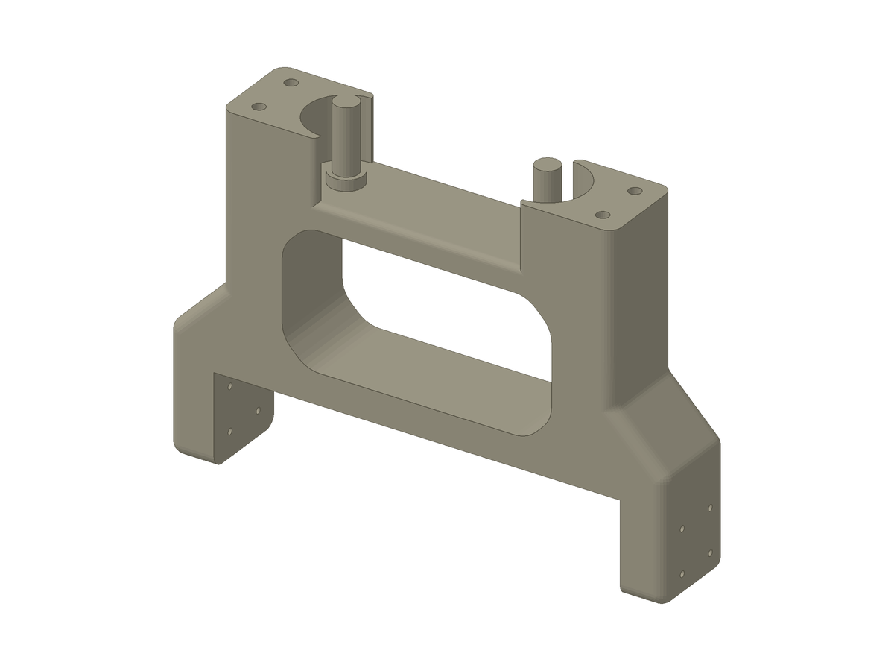](mechanical/steering/Idler%20Tensioner%20Body.stl) | **Idler tensioner body**<br>[Idler Tensioner Body.stl](mechanical/steering/Idler%20Tensioner%20Body.stl)<br>161 × 30 × 117 mm | Steering belt drive: body of the idler/tensioner assembly. |
| [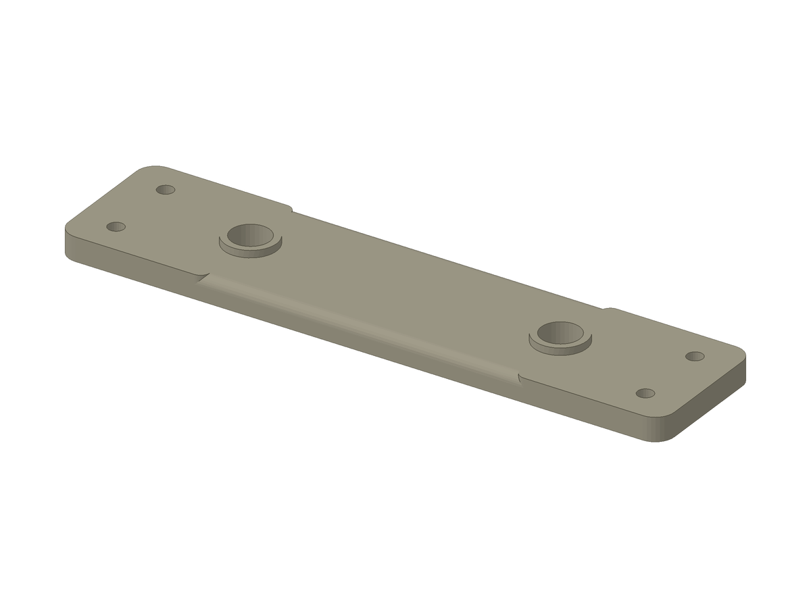](mechanical/steering/Idler%20Tensioner%20Cover.stl) | **Idler tensioner cover**<br>[Idler Tensioner Cover.stl](mechanical/steering/Idler%20Tensioner%20Cover.stl)<br>127 × 30 × 6.5 mm | Steering belt drive: cover for the idler/tensioner assembly. |
| [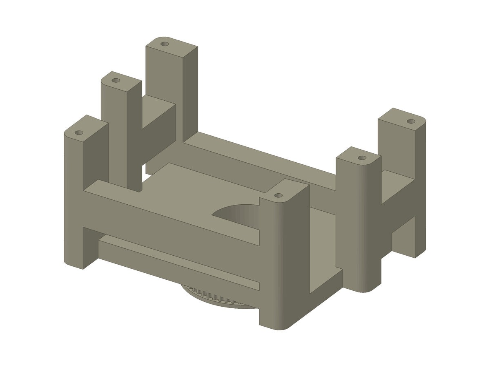](mechanical/steering/Chestplate%20Mount.stl) | **Chestplate mount**<br>[Chestplate Mount.stl](mechanical/steering/Chestplate%20Mount.stl)<br>231 × 164 × 133.5 mm | Steering-wheel interface: chestplate fitted over the steering wheel to transmit the steering drive and turn the wheel. |
| [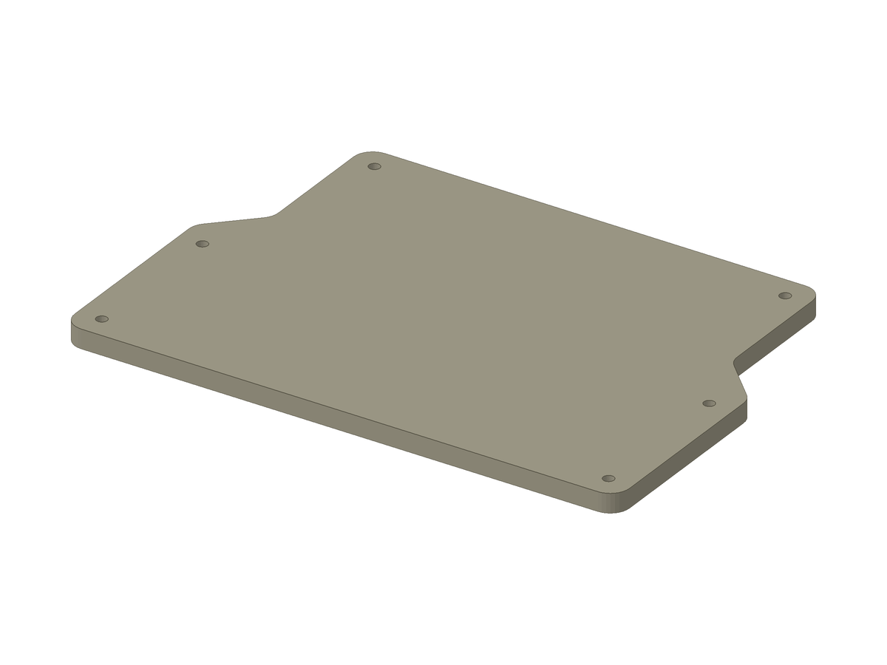](mechanical/steering/Chestplate%20Cover.stl) | **Chestplate cover**<br>[Chestplate Cover.stl](mechanical/steering/Chestplate%20Cover.stl)<br>231 × 164 × 8 mm | Steering-wheel interface: cover for the chestplate assembly fitted over the steering wheel. |

## Camera rig

Front, rear, side, and PVC-mounted camera hardware, including the vibration-damped front/rear connectors. The filename marked `OLD` is an earlier front-holder revision.

| CAD preview | Component / original file | Cart location and purpose |
|:--|:--|:--|
| [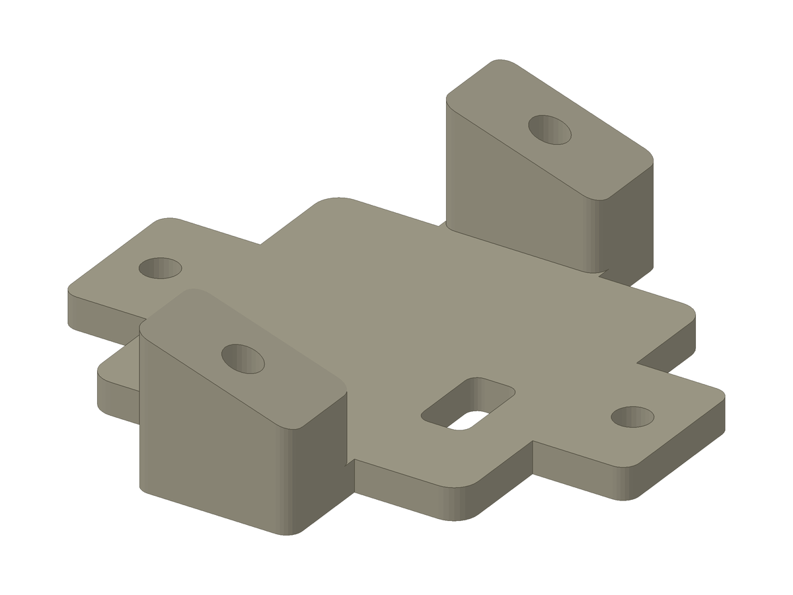](mechanical/cameras/Cam%20to%20Cart%20Mount.stl) | **Camera-to-cart mount**<br>[Cam to Cart Mount.stl](mechanical/cameras/Cam%20to%20Cart%20Mount.stl)<br>71 × 71 × 19 mm | Camera rig: mounting interface between a camera bracket and the cart. |
| [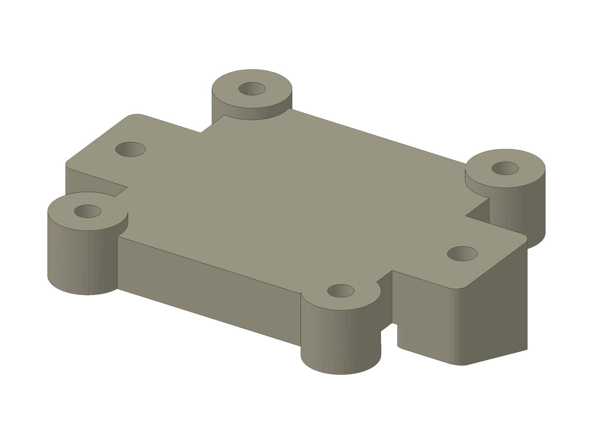](mechanical/cameras/Front%20Cam%20Attachment.stl) | **Front camera attachment**<br>[Front Cam Attachment.stl](mechanical/cameras/Front%20Cam%20Attachment.stl)<br>71 × 57 × 21 mm | Front camera rig: attachment plate/interface. |
| [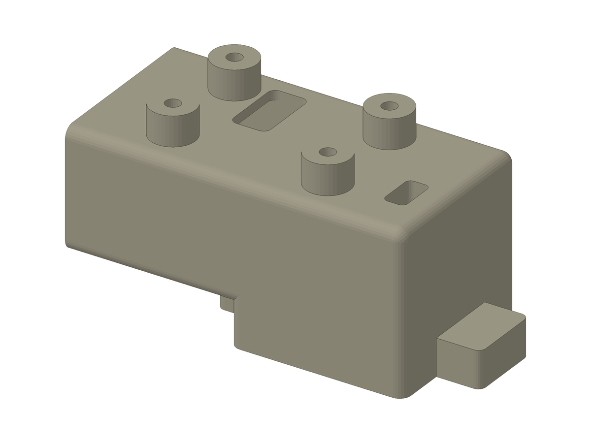](mechanical/cameras/Front%20Cam%20Holder.stl) | **Front camera holder**<br>[Front Cam Holder.stl](mechanical/cameras/Front%20Cam%20Holder.stl)<br>103 × 47 × 51 mm | Front camera rig: camera holder. |
| [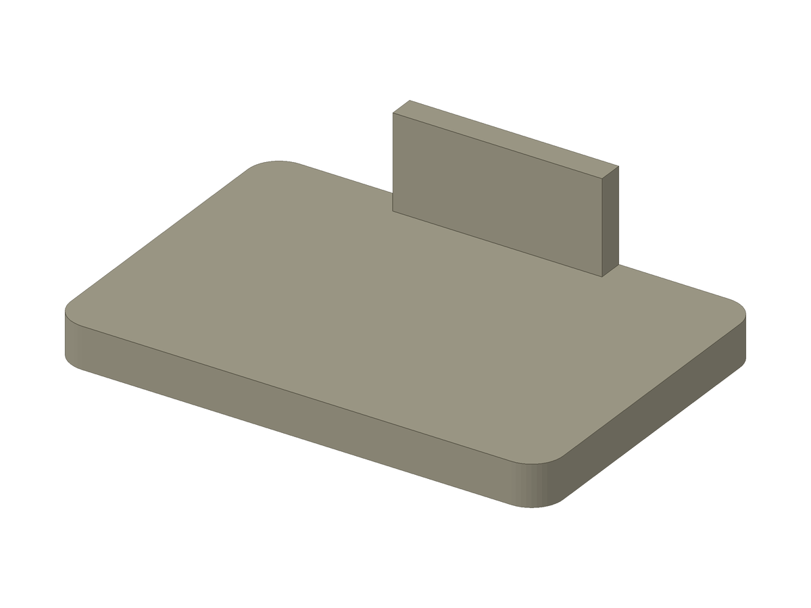](mechanical/cameras/Front%20Cam%20Cap.stl) | **Front camera cap**<br>[Front Cam Cap.stl](mechanical/cameras/Front%20Cam%20Cap.stl)<br>47 × 32 × 13 mm | Front camera rig: cap for the front camera holder. |
| [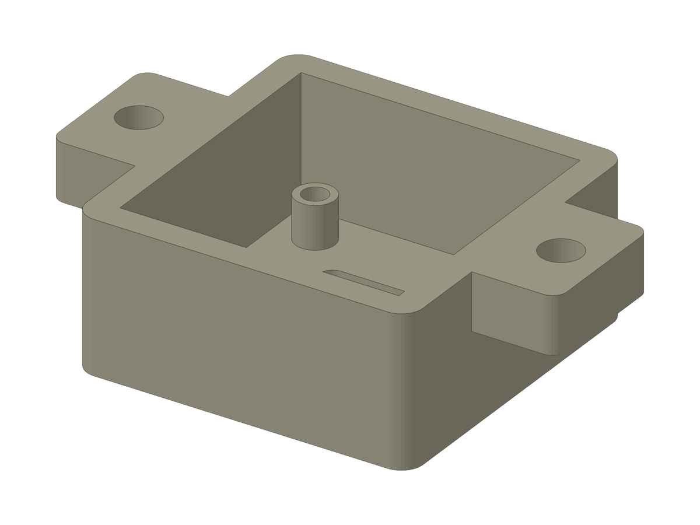](mechanical/cameras/Front%20Wide%20Cam%20Holder.stl) | **Front wide-camera holder**<br>[Front Wide Cam Holder.stl](mechanical/cameras/Front%20Wide%20Cam%20Holder.stl)<br>71 × 47 × 22 mm | Front wide-angle camera: camera holder. |
| [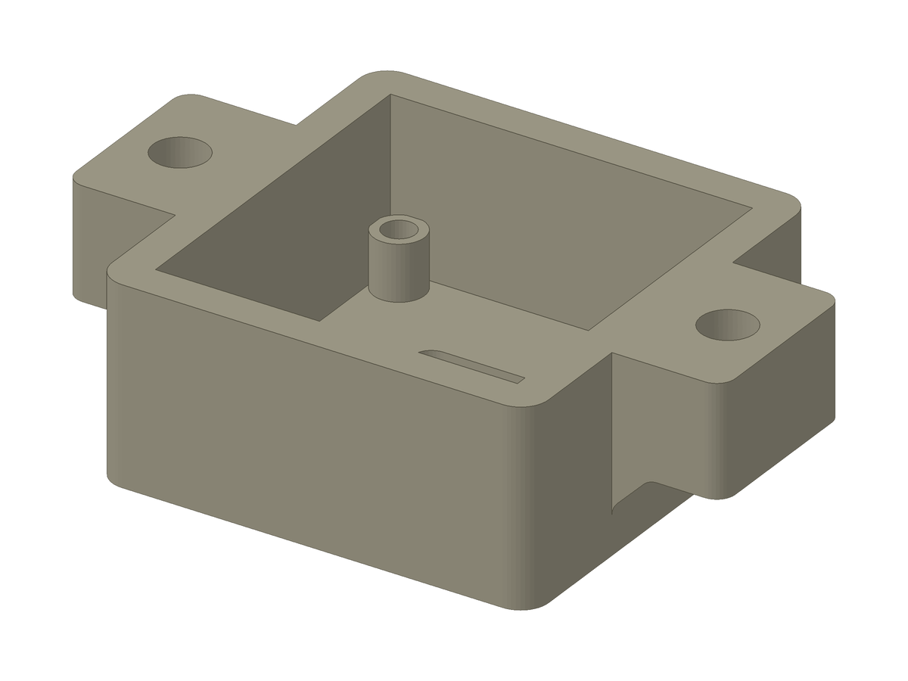](mechanical/cameras/Side%20Cam%20Holder.stl) | **Side camera holder**<br>[Side Cam Holder.stl](mechanical/cameras/Side%20Cam%20Holder.stl)<br>71 × 47 × 22 mm | Side-facing camera rig: camera holder. |
| [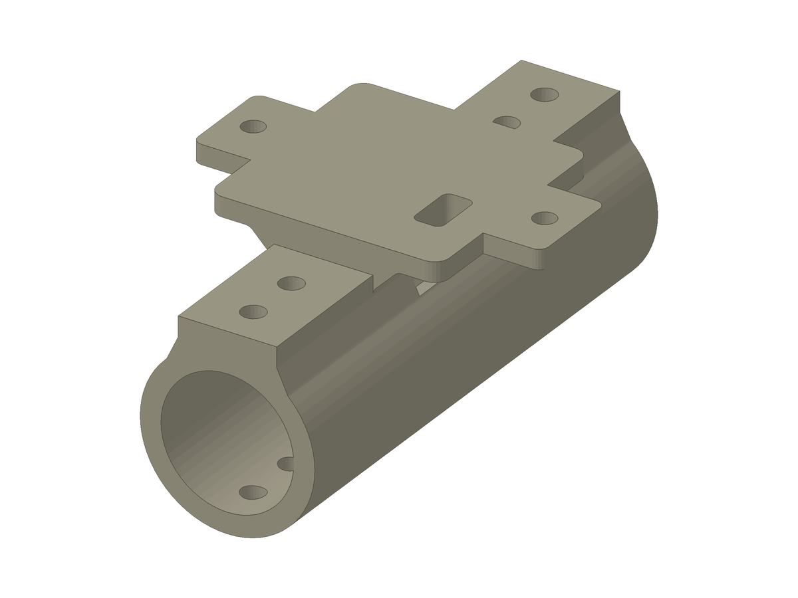](mechanical/cameras/PVC%20Cam%20Holder%20Norm.stl) | **PVC camera holder, normal**<br>[PVC Cam Holder Norm.stl](mechanical/cameras/PVC%20Cam%20Holder%20Norm.stl)<br>71 × 107 × 45.4 mm | PVC camera rig: normal variant of the tube-mounted bracket. |
| [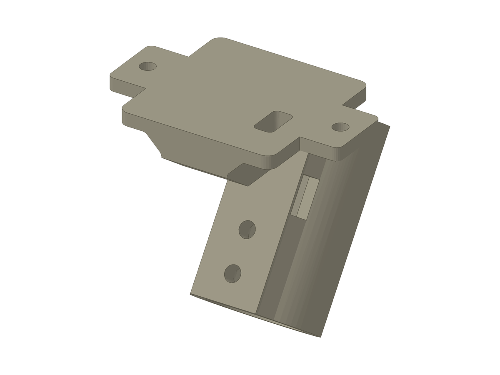](mechanical/cameras/PVC%20Cam%20Holder%20Left.stl) | **PVC camera holder, left**<br>[PVC Cam Holder Left.stl](mechanical/cameras/PVC%20Cam%20Holder%20Left.stl)<br>71 × 76 × 77 mm | PVC camera rig: left variant of the tube-mounted bracket. |
| [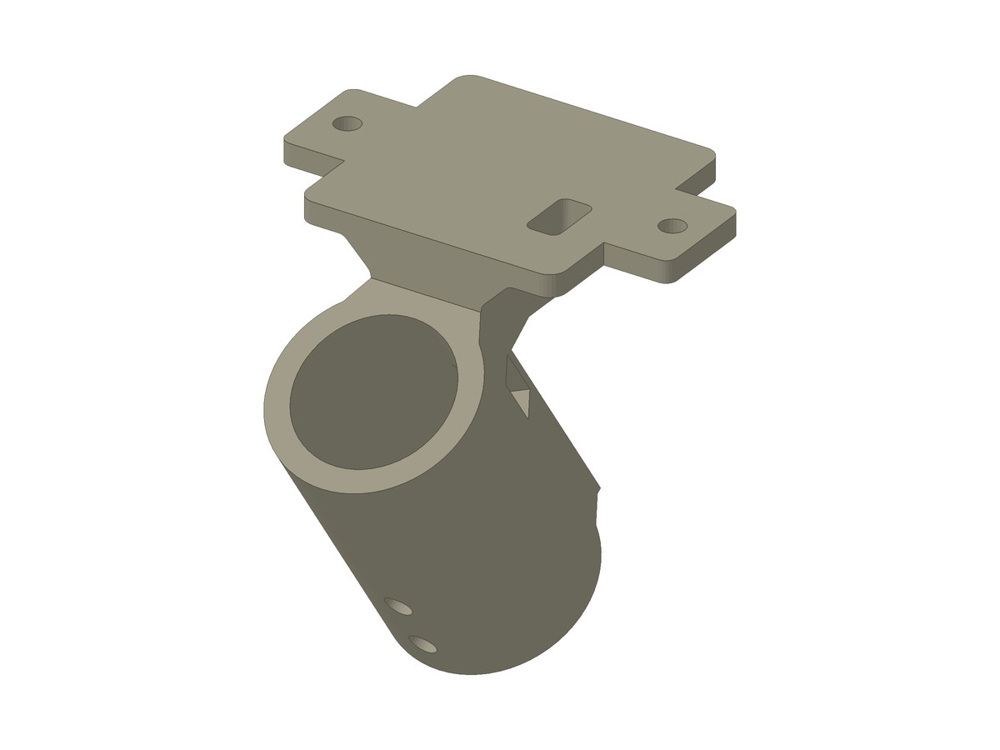](mechanical/cameras/PVC%20Cam%20Holder%20Right.stl) | **PVC camera holder, right**<br>[PVC Cam Holder Right.stl](mechanical/cameras/PVC%20Cam%20Holder%20Right.stl)<br>71 × 76 × 77 mm | PVC camera rig: right variant of the tube-mounted bracket. |
| [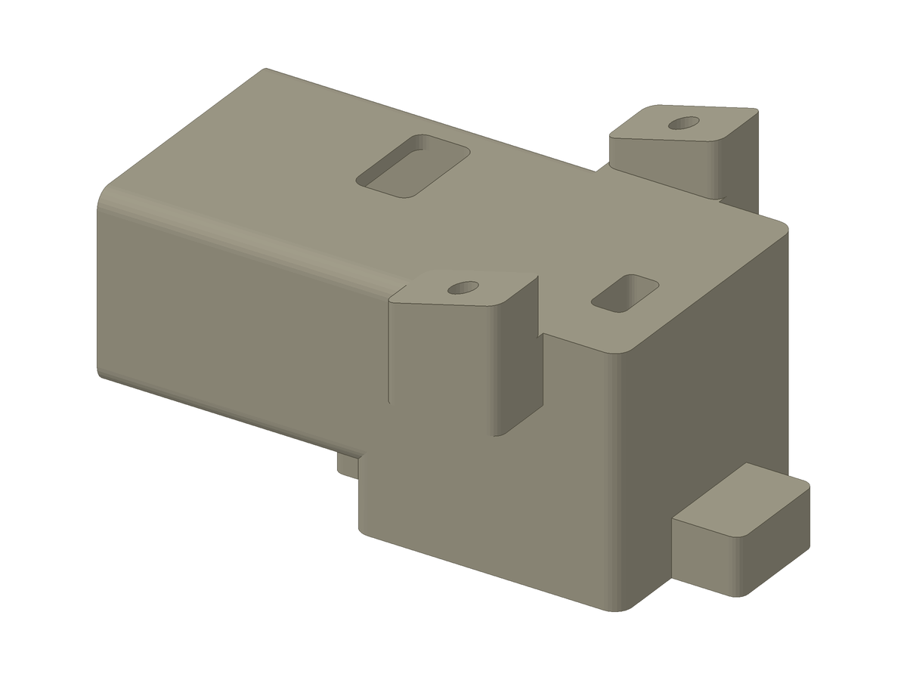](mechanical/cameras/Front%20Cam%20Holder%20%28OLD%29.stl) | **Front camera holder, old revision**<br>[Front Cam Holder (OLD).stl](mechanical/cameras/Front%20Cam%20Holder%20%28OLD%29.stl)<br>103 × 71 × 53 mm | Earlier front camera holder export; retained separately from the unmarked revision. |
| [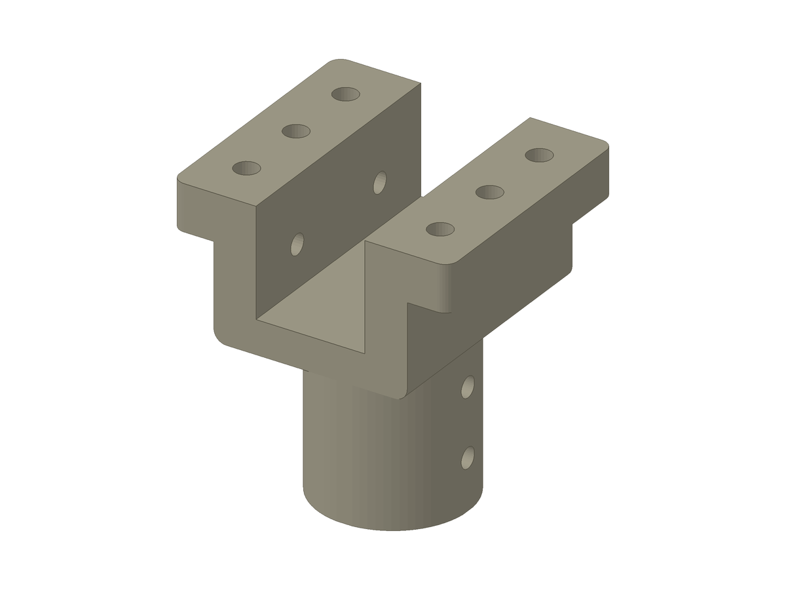](mechanical/cameras/Front%20Connector.stl) | **Front connector**<br>[Front Connector.stl](mechanical/cameras/Front%20Connector.stl)<br>65.7 × 60 × 73.6 mm | Front camera mounting: holds the front camera in place with a vibration damper. |
| [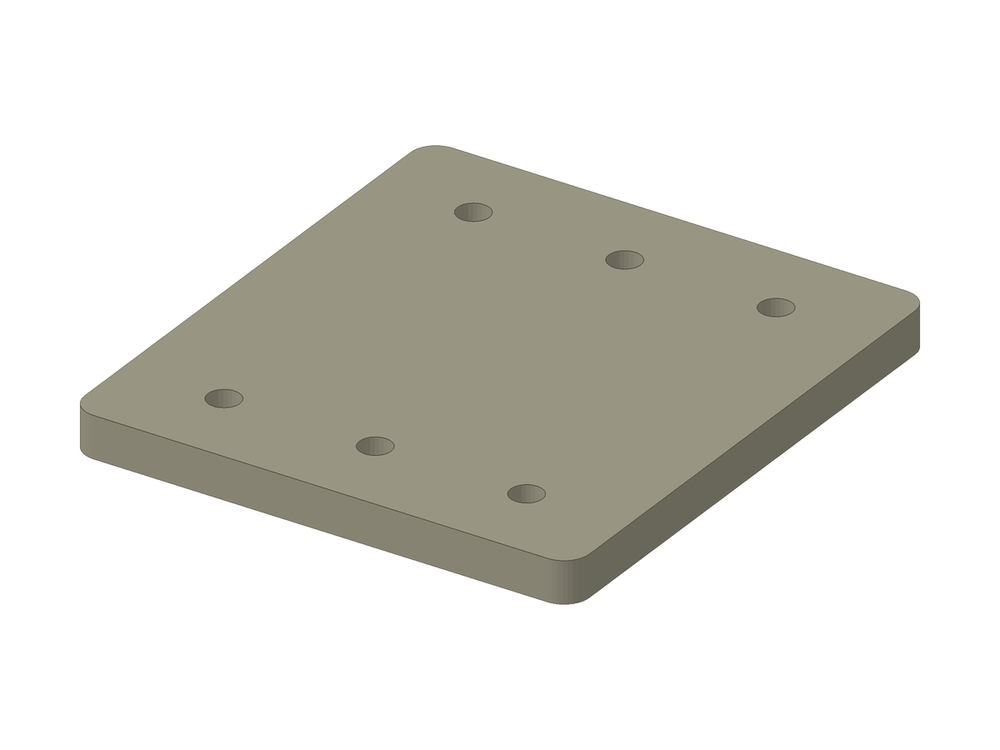](mechanical/cameras/Front%20Connector%20Cap.stl) | **Front connector cap**<br>[Front Connector Cap.stl](mechanical/cameras/Front%20Connector%20Cap.stl)<br>60 × 65.7 × 5 mm | Front camera mounting: cap for the vibration-damped front connector assembly. |
| [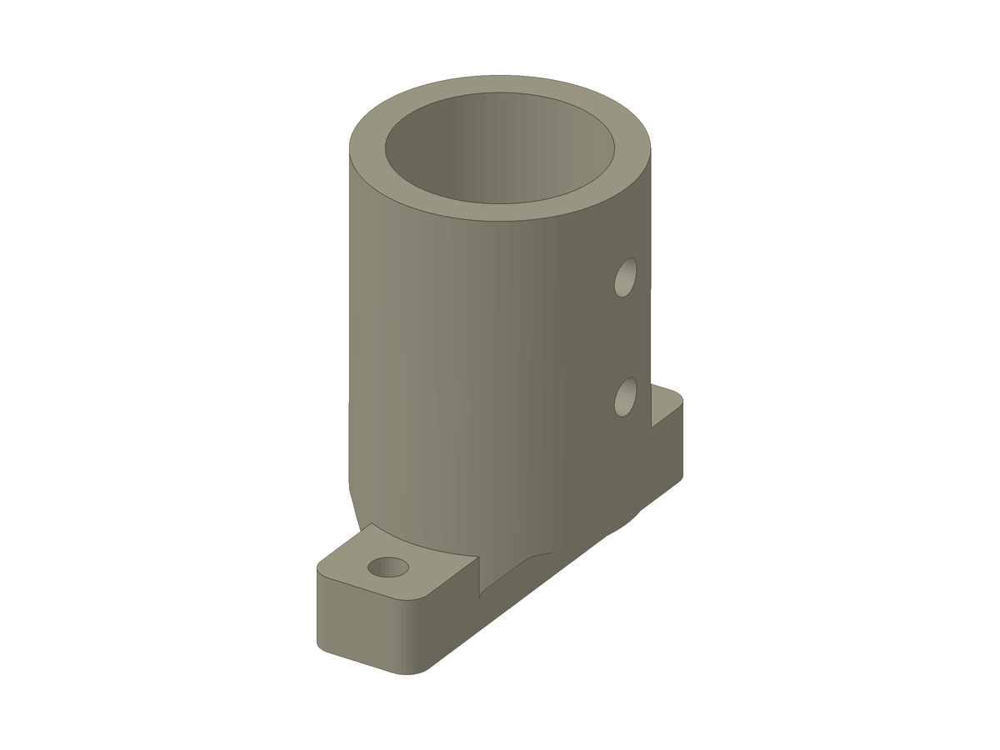](mechanical/cameras/Back%20Connector.stl) | **Back connector**<br>[Back Connector.stl](mechanical/cameras/Back%20Connector.stl)<br>35.4 × 60 × 55 mm | Rear camera mounting: holds the rear camera in place with a vibration damper. |

## Sensor housings

Dedicated housings for the GPS and IMU. Each export includes its separately positioned lid.

| CAD preview | Component / original file | Cart location and purpose |
|:--|:--|:--|
| [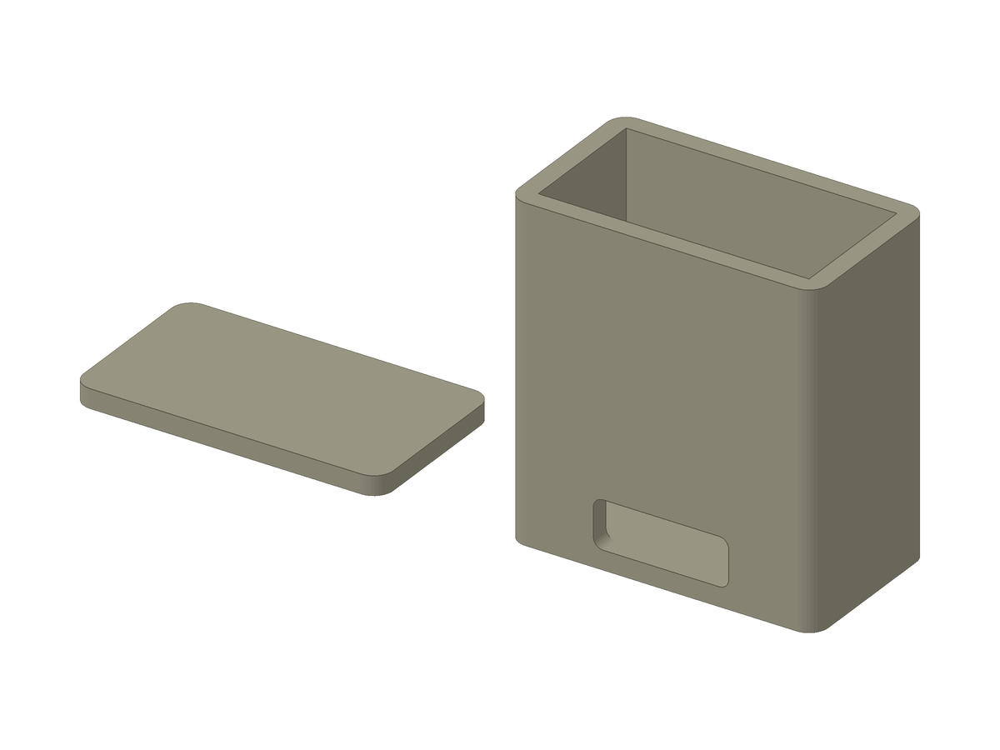](mechanical/sensors/GPS%20Housing.stl) | **GPS housing**<br>[GPS Housing.stl](mechanical/sensors/GPS%20Housing.stl)<br>77 × 18 × 34 mm | GPS sensor mounting: housing export includes the enclosure and a separate lid. |
| [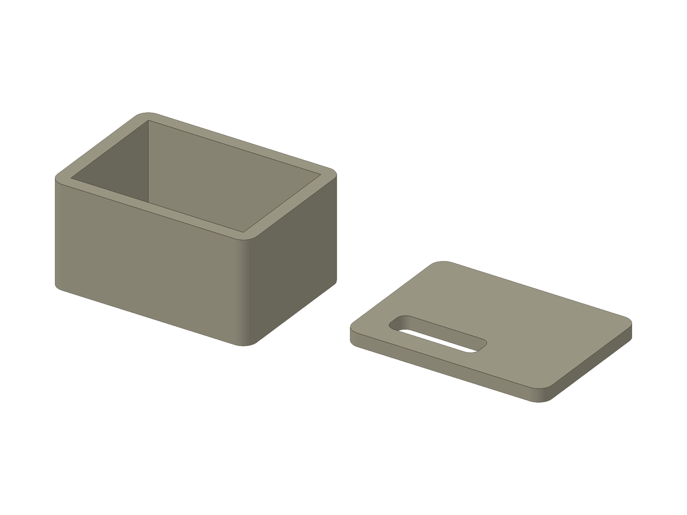](mechanical/sensors/IMU%20Holster.stl) | **IMU holster**<br>[IMU Holster.stl](mechanical/sensors/IMU%20Holster.stl)<br>103.9 × 45 × 23 mm | IMU sensor mounting: holster export includes the enclosure and a separate lid. |

## Display and connectivity

Mounts for the operator display and Starlink equipment.

| CAD preview | Component / original file | Cart location and purpose |
|:--|:--|:--|
| [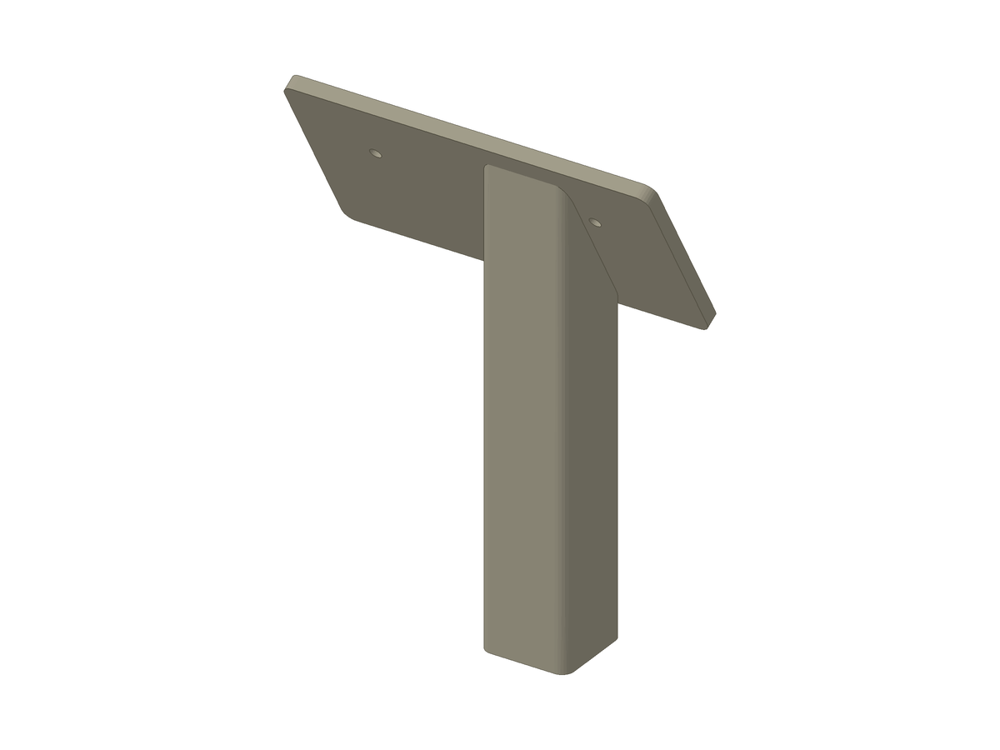](mechanical/accessories/Monitor%20Mount.stl) | **Monitor mount**<br>[Monitor Mount.stl](mechanical/accessories/Monitor%20Mount.stl)<br>125 × 38.3 × 169.4 mm | Operator display: mounting bracket for the monitor. |
| [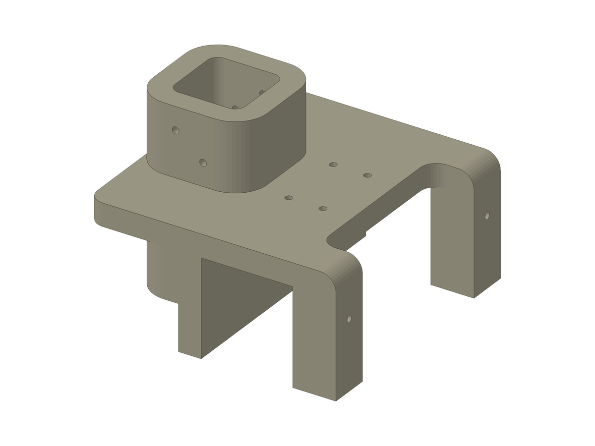](mechanical/accessories/Monitor%20Stand.stl) | **Monitor stand**<br>[Monitor Stand.stl](mechanical/accessories/Monitor%20Stand.stl)<br>109 × 111 × 82.5 mm | Operator display: support stand for the monitor. |
| [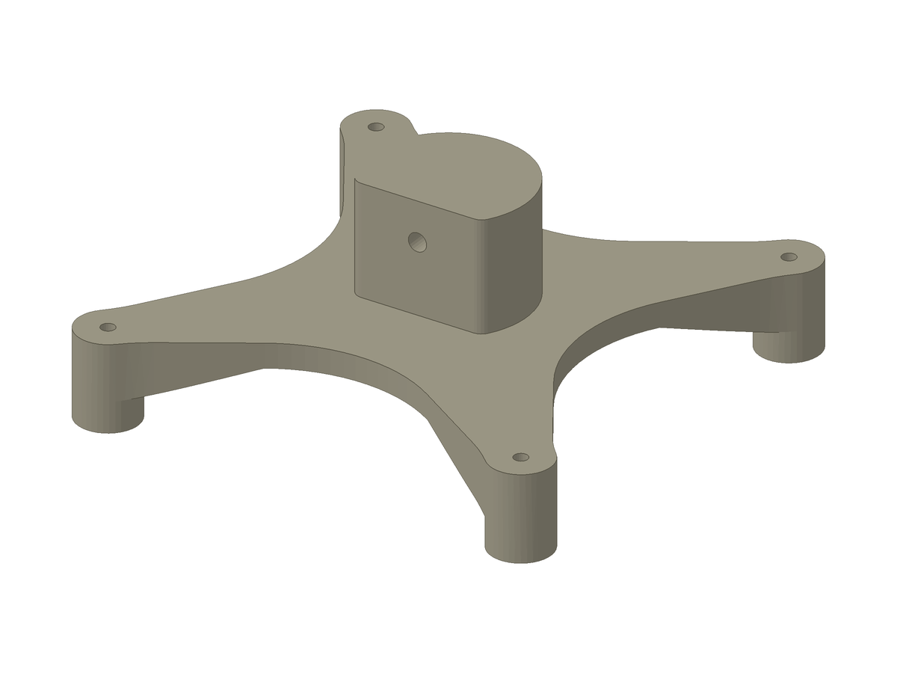](mechanical/accessories/Starlink%20Mount.stl) | **Starlink mount**<br>[Starlink Mount.stl](mechanical/accessories/Starlink%20Mount.stl)<br>155.9 × 155.8 × 64 mm | Connectivity hardware: mount for the Starlink equipment. |

## Hardware and firmware

| Subsystem | Hardware documented in this repository |
|:--|:--|
| Compute | NVIDIA Jetson AGX Thor |
| Steering | ODrive S1 + M8325s motor, 3:1 HTD 5M belt drive |
| Pedals | 2 linear actuators with potentiometer feedback, 2 BTS7960 H-bridges, Arduino Mega 2560 |
| GNSS | u-blox ZED-F9x RTK receiver with NTRIP corrections |
| Cameras | USB camera rig, including a 170° fisheye front camera |
| Safety | Hardware e-stop and firmware heartbeat watchdog |
| Power | 48 V cart pack with dedicated 12 V and 5 V buck rails |

Subsystem documentation: [steering](../docs/steering.md) · [pedal actuators](../docs/linear_actuators.md) · [e-stop](../docs/estop.md) · [GPS](../docs/gps.md) · [cameras](../docs/cameras.md).

## Directory guide

| Directory | Contents |
|:--|:--|
| [`mechanical/pedals/`](mechanical/pedals/) | Gas/brake cases and covers, piston arm, gripper, and column stand. |
| [`mechanical/steering/`](mechanical/steering/) | Chestplate, steering column mount, motor reference, pulley, and tensioner. |
| [`mechanical/cameras/`](mechanical/cameras/) | Camera holders, caps, attachment plates, and damped connector brackets. |
| [`mechanical/sensors/`](mechanical/sensors/) | GPS housing and IMU holster. |
| [`mechanical/accessories/`](mechanical/accessories/) | Monitor and Starlink mounts. |
| [`cad/catalog.json`](cad/catalog.json) | Component descriptions, paths, mesh dimensions, triangle counts, and original-file SHA-256 checksums. |
| [`renders/`](renders/) | One PNG per export, selected-parts overview, and full catalog. |
| [`tools/`](tools/) | Reproducible geometry renderer. |
| [`arduino-sketches/`](arduino-sketches/) | Pedal control, watchdog, sensor-validation firmware, and upload tooling. See its [README](arduino-sketches/README.md). |
| [`sensors/calibration/`](sensors/calibration/) | Camera intrinsics/extrinsics and calibration boards. |
| [`electrical/`](electrical/) | Reserved for wiring diagrams, power distribution, and harness pinouts; no electrical drawings imported in this batch. |
| [`pcb/`](pcb/) | Reserved for board designs and fabrication files; none imported in this batch. |

## Regenerate the renders

The renderer reads the actual STL triangles, shades them in an orthographic view, and adds visible silhouettes and creases against a white background. It uses a depth buffer so hidden faces do not show through the models.

From the repository root, with Python, NumPy, and Pillow installed:

```bash
python3 hardware/tools/render_cad.py
```

Render one component or rebuild the overview/catalog from existing PNGs:

```bash
python3 hardware/tools/render_cad.py --only pedal-case-brake-u
python3 hardware/tools/render_cad.py --sheets-only
```

The component IDs and metadata live in [`cad/catalog.json`](cad/catalog.json). [CMU Serif](tools/fonts/cmu/) and [Geist](tools/fonts/geist/) font files and their licenses are bundled, so the images regenerate with the same typography on any machine. The render script does not modify the source STLs.
